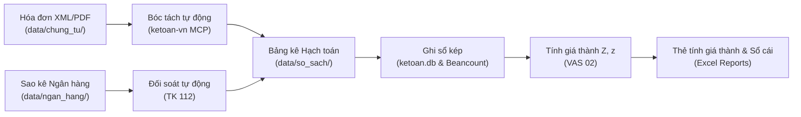

# HỆ THỐNG TRỢ LÝ KẾ TOÁN AI & QUẢN TRỊ SỔ SÁCH DOANH NGHIỆP (VIETNAM ACCOUNTING SYSTEM)

Hệ thống quản lý, tự động hóa hạch toán chứng từ, tính giá thành sản xuất và lập sổ sách kế toán theo quy định chuẩn mực kế toán Việt Nam (**Thông tư 99/2025/TT-BTC**, **Thông tư 200/2014/TT-BTC**, **Thông tư 133/2016/TT-BTC** và **Thông tư 58/2026/TT-BTC**).

---

## 1. KIẾN TRÚC THƯ MỤC CHUẨN (PROJECT STRUCTURE)

```text
F:\Accountant
├── .agents/                        # Định nghĩa Skills & Hướng dẫn nghiệp vụ chuyên sâu cho Agent
│   └── skills/
│       ├── doi-soat-ngan-hang/     # Kỹ năng đối soát sao kê ngân hàng & Sổ TK 112
│       ├── ke-toan-gia-thanh/      # Quy trình phân bổ SXC & tính giá thành sản phẩm (Z, z)
│       └── xu-ly-hoa-don/          # Kỹ năng bóc tách hóa đơn XML & PDF điện tử
│
├── data/                           # Toàn bộ dữ liệu nghiệp vụ kế toán thực tế (Data Isolation)
│   ├── chung_tu/                   # Chứng từ gốc & hóa đơn đầu vào / ngân hàng
│   │   ├── hoa_don_mua_vao/        # Hóa đơn GTGT mua vào theo kỳ kế toán (VD: 2026-07/)
│   │   └── hoa_don_bank/           # Hóa đơn phí dịch vụ ngân hàng tự động tải (VD: 2026-10/)
│   ├── ngan_hang/                  # Dữ liệu giao dịch ngân hàng
│   │   └── sao_ke/                 # File Excel/PDF sao kê ngân hàng gốc (Vietcombank, ...)
│   ├── so_sach/                    # Sổ sách, bảng kê hạch toán & danh mục đối soát
│   │   ├── danh_muc/               # Danh mục Hàng hóa Dịch vụ, Nhà cung cấp
│   │   └── bang_ke_hach_toan/      # Bảng kê mua hàng, xuất kho, cấp vật tư, bảng hạch toán tháng
│   └── database/                   # Cơ sở dữ liệu giao dịch & Sổ cái Plaintext
│       ├── ketoan.db               # SQLite Database lưu trữ sổ Nhật ký chung & giao dịch
│       └── so_cai.beancount        # Sổ cái kế toán kép Plaintext Double-Entry Accounting
│
├── docs/                           # Tài liệu hướng dẫn & quy tắc nghiệp vụ nội bộ
│   ├── Quy_Tac_Hach_Toan_Dau_Vao.md        # Nguyên tắc đặt mã hàng hóa, nhà cung cấp, định khoản
│   └── Huong_Dan_Hach_Toan_MISA_TT133.docx # Tài liệu nghiệp vụ xử lý giá thành trên phần mềm
│
├── sources/                        # Thư mục tiếp nhận văn bản pháp luật gốc Cấp 1 (PDF)
│
├── tests/                          # Bộ kiểm thử hệ thống tự động (Automated Test Suite)
│   ├── run_all_tests.py            # Kịch bản kiểm thử toàn diện 8 bài test nghiệp vụ
│   ├── test_gia_thanh.py           # Kịch bản kiểm thử chuyên sâu Kế toán Giá thành
│   ├── test_data/                  # Dữ liệu mẫu (Mock data: XML, PDF) phục vụ test
│   └── test_output/                # Thư mục chứa file Excel kết quả test (.gitignore)
│
├── tools/                          # Các script tự động hóa & MCP Server kế toán
│   ├── ketoan_server.py            # Model Context Protocol (MCP) Server cung cấp API kế toán
│   ├── download_month_invoices.py  # Script tự động tải hóa đơn ngân hàng cả tháng qua API
│   ├── download_vcb_invoice.py     # Script tải hóa đơn VCB theo ngày chỉ định
│   ├── generate_test_pdf.py        # Script sinh hóa đơn PDF mẫu kiểm thử
│   └── create_word_doc.py          # Script sinh tài liệu Word nghiệp vụ tự động
│
├── .gitignore                      # Cấu hình bỏ qua file tạm, file test output & DB
├── AGENTS.md                       # Quy chuẩn, đạo đức & chỉ dẫn hành vi cốt lõi của Agent (Root)
├── legal-basis.md                  # Danh mục căn cứ pháp lý & ma trận tra cứu hiệu lực (Root)
├── README.md                       # Tài liệu hướng dẫn tổng thể dự án
└── run_all_tests.py                # Wrapper thực thi nhanh toàn bộ bài test từ thư mục gốc
```

---

## 2. NGUYÊN TẮC TỔ CHỨC & PHÂN TÁCH DỮ LIỆU

1. **Chuẩn hóa đặt tên file & thư mục (Clean Naming Convention):**
   - Loại bỏ hoàn toàn khoảng trắng, dấu tiếng Việt và chữ hoa không cần thiết trong cấu trúc thư mục hệ thống.
   - Thư mục chứng từ được đánh chỉ mục thời gian theo chuẩn ISO: `YYYY-MM` (ví dụ: `2026-07/`, `2026-10/`).
2. **Tách biệt Dữ liệu (Data) - Mã nguồn (Code) - Tài liệu (Docs):**
   - `data/`: Lưu trữ dữ liệu thực tế phát sinh của doanh nghiệp (chứng từ gốc, sao kê, sổ sách Excel, DB).
   - `tests/`: Tách riêng hoàn toàn dữ liệu giả lập (`test_data/`) và kết quả sinh file tạm (`test_output/`) khỏi dữ liệu sản xuất.
   - `docs/`: Tập trung quy tắc hạch toán và tài liệu nghiệp vụ kế toán nội bộ.
3. **Bảo tồn vị trí tệp tin cốt lõi:**
   - `AGENTS.md` và `legal-basis.md` được giữ cố định tại thư mục gốc (`F:\Accountant`) để đảm bảo hệ thống quy tắc cốt lõi của AI Agent luôn được nạp chính xác.
   - `sources/` được duy trì tại gốc để tiếp nhận trực tiếp các tệp văn bản quy phạm pháp luật Cấp 1 dạng PDF.

---

## 3. HƯỚNG DẪN KIỂM THỬ (TESTING GUIDE)

Hệ thống được trang bị bộ kiểm thử toàn diện bảo đảm mọi công cụ tính toán, bóc tách và tra cứu đều chuẩn xác 100%:

### Cách chạy toàn bộ 8 bài kiểm thử:
Từ thư mục gốc `F:\Accountant`, chạy lệnh:
```bash
python run_all_tests.py
# hoặc
python tests/run_all_tests.py
```

### Nội dung 8 bài kiểm thử:
1. **Tra cứu tài khoản (lookup_accounting_account):** Xác minh nhận diện Chế độ Kế toán (`regime="TT99" | "TT200" | "TT133"`), phân biệt các tài khoản bãi bỏ và tài khoản đổi tên.
2. **Bóc tách hóa đơn XML (parse_vietnamese_invoice_xml):** Trích xuất thông tin người bán, người mua, danh mục hàng hóa, thuế GTGT.
3. **Xuất bảng kê Excel hàng loạt (batch_export_invoices_to_excel):** Quét thư mục hóa đơn và xuất file Excel 2 sheet (Tổng hợp & Chi tiết).
4. **Cơ sở dữ liệu SQLite (ketoan.db):** Kiểm tra tính toàn vẹn giao dịch và cân đối Nợ - Có.
5. **Sinh Sổ Nhật ký chung Excel:** Tạo sổ nhật ký chung chuẩn định dạng.
6. **Bóc tách hóa đơn PDF (parse_vietnamese_invoice_pdf):** Trích xuất thông tin hóa đơn từ file PDF dạng scan/điện tử.
7. **Kiểm tra Sổ cái Beancount (verify_beancount_ledger):** Xác minh tính hợp lệ và cân đối của sổ kế toán kép Plaintext.
8. **Kế toán Giá thành theo các Chế độ (calculate_product_cost):** Tính giá thành $Z$, đơn giá $z$, phân bổ chi phí SXC theo VAS 02 và định khoản đúng theo từng thông tư.

### Chạy kiểm thử chuyên sâu Kế toán Giá thành:
```bash
python tests/test_gia_thanh.py
```
Kiểm tra chi tiết tính toán giá thành giản đơn, phân bổ chi phí SXC theo tiêu thức nguyên vật liệu trực tiếp và xuất Thẻ tính giá thành sản phẩm ra Excel.

---

## 4. QUY TRÌNH HẠCH TOÁN & TỰ ĐỘNG HÓA


